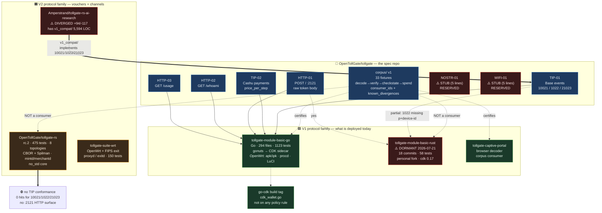
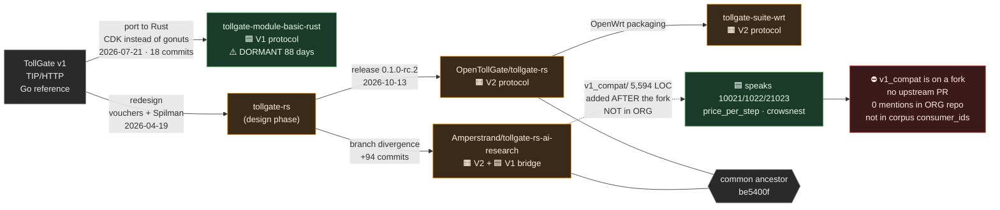
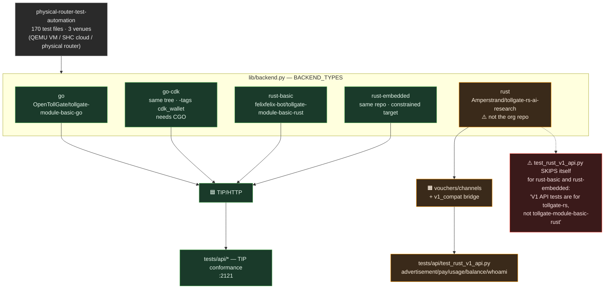
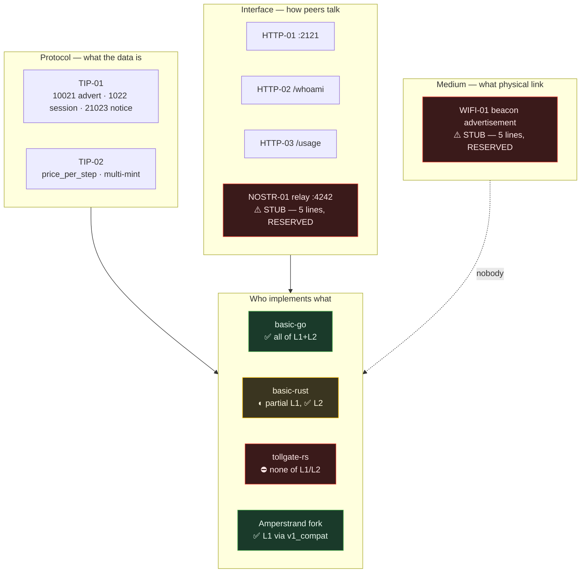

# TollGate implementation map

Visual map of **every** TollGate implementation: what exists, which protocol each speaks, and how
they relate. Built because the fleet is larger than it looks — **six implementations across two
different protocols** — and the relationships were only discoverable by reading six repos.

**Evidence date: 2026-10-18** (§1–6). **Update: 2026-10-21** (§7 — a seventh implementation went
green, the Amperstrand fork became the org's deliberate production home, and
the dormant Rust module woke up on a fork).
Every claim here is measured, not inferred from a README. Method and
reproduction commands: [METHOD.md](METHOD.md).

---

## 1. The headline: two protocols share one name



**The two protocols, stated plainly:**

| | 🟦 V1 (TIP/HTTP) | 🟧 V2 (vouchers/channels) |
|---|---|---|
| Payment unit | a Cashu token worth **N steps** of time/bytes | **1 voucher = 1 byte**, from the node's own mint |
| Who mints | external mints (operator allowlist) | **the node itself** (`mintd`) |
| Settlement | direct token swap per purchase | **Spilman payment channel**, 2-of-2, rollover |
| Metering | whole steps, session allotment | **reserved rate + per-second draws**, `burst` |
| Budget durability | session metering **in memory** (documented gap) | **`budgets-<instance>.json`, survives restart** |
| Wire format | HTTP `:2121` + Nostr events 10021/1022/21023 | **CBOR over raw TCP**, normative CDDL |
| Browser path | native (captive portal is the point) | **fallback only** (`proxyd` in suite-wrt) |
| Canonical client | browser / any HTTP client | **`tollgate_net::client::run`** (agents, native) |
| Spec location | `OpenTollGate/tollgate` TIP-01/02, HTTP-01/02/03 | `tollgate-rs/docs/design/` + `tollgate.cddl` |

---

## 2. Lineage — and the bridge nobody tracks



### The `v1_compat/` discovery

`Amperstrand/tollgate-rs-ai-research-and-experiments` contains
`crates/tollgate-net/src/v1_compat/` — **16 modules, 5,594 lines** — implementing the V1 surface:

```
adapter.rs   client.rs    crowsnest.rs  handlers.rs     http_client.rs  ln_quotes.rs
mac_resolver.rs  merchant.rs  mint_health.rs  mod.rs  nostr.rs  pricing.rs
recovery.rs  session_manager.rs  usage_tracker.rs  wallet.rs
```

`v1_compat/nostr.rs` declares the kind table explicitly:

```
| 10021 | TollGateAdvertisement | TollGate discovery (advertisement) |
| 1022  | SessionEvent          | Session grant after successful payment |
| 21023 | NoticeEvent           | Error / warning / info notice |
```

**Proven to be post-fork:** the path does not exist at the shared ancestor `be5400f`
(`git cat-file` → *"exists on disk, but not in be5400f"*), and it was added by three commits after
the divergence.

**Why this matters:** the two designs are *already reconciled in code* — by one person, on a personal
fork, with **no upstream PR**, **zero mentions in the org repo**, and **no entry in the corpus's
`consumer_ids`**. It is the cheapest path to "multiple interoperable implementations" and it is one
`rm -rf` from gone.

---

## 3. What the test framework actually exercises



**Naming trap:** PRTA's `--backend rust` does **not** mean `OpenTollGate/tollgate-rs`. It maps to
`Amperstrand/tollgate-rs-ai-research-and-experiments`. The org repo is not a test backend at all.
This cost a full wrong analysis before it was caught — see [METHOD.md](METHOD.md#correction-log).

---

## 4. Protocol layers and who fills them



---

## 5. Capability matrix (measured)

| Capability | basic-go | basic-rust | tollgate-rs (org) | Amperstrand fork |
|---|---|---|---|---|
| TIP-01 10021 advertisement | ✅ | ✅ | ⛔ | ✅ via `v1_compat` |
| TIP-01 1022 session (`p`, `device-identifier`, `allotment`) | ✅ | ◐ `allotment`+`metric` only | ⛔ | ✅ via `v1_compat` |
| TIP-01 21023 notice (`level`, `code`) | ✅ | ◐ `{kind,content}` only | ⛔ | ✅ via `v1_compat` |
| TIP-02 `price_per_step` multi-mint | ✅ | ✅ | ⛔ | ✅ |
| HTTP-01 `POST /` :2121 raw body | ✅ | ✅ | ⛔ | ✅ |
| HTTP-02 `/whoami` | ✅ | ◐ | ⛔ | ✅ |
| HTTP-03 `/usage` | ✅ | ✅ | ⛔ | ✅ |
| Spilman payment channels | ⛔ | ⛔ | ✅ | ✅ |
| Budgets persisted across restart | ⛔ (session in memory) | ⛔ | ✅ | ✅ |
| Own mint (`mintd`) | ⛔ | ⛔ | ✅ | ✅ |
| External enforcer protocol | ⛔ | ⛔ | ✅ | ✅ |
| `no_std` core (embedded) | ⛔ | ⛔ | ✅ | ✅ |
| OpenWrt packaging | ✅ mature | ◐ | via suite-wrt | ✅ |
| LuCI web UI | ✅ | ? | ⛔ (`tolltop` TUI) | ? |
| Corpus consumer | ✅ | ⛔ | ⛔ | ⛔ |
| Tests (in-tree) | 1123 | 58 | 475 | ? |
| Last activity | 2026-10-17 | **2026-07-21** | 2026-10-13 | 2026-10-16 |

---

## 6. Known hazards, at a glance

| Hazard | Where |
|---|---|
| `NOSTR-01` and `WIFI-01` are **5-line RESERVED stubs**, yet the spec README offers recipes ("WiFi hotspot (full)", "Nostr-only") built on them | `OpenTollGate/tollgate` |
| `v1_compat/` bridge exists **only on a personal fork**, no PR, not in `consumer_ids` | `Amperstrand/…` |
| PRTA's `rust` backend is **not the org repo** | `lib/backend.py` |
| Known-good corpus state is **not green** — portal V2-keyset divergence open | `corpus/manifest.json` |
| `gonuts` upstream is **archived** (2025-08-16); fork can never merge back | `elnosh/gonuts` |
| `cdk-walletd` has **no packaging anywhere** yet policy points every target at its socket | `tollgate-module-basic-go` |
| `tollgate-rs` channels are **memory-only** across restart; buyer **cannot yet pay a seller** | rc.2 release notes |
| `tollgate-rs` is effectively **single-maintainer** (`Origami74` = 159/167 commits) | org repo |

---

## 7. Update 2026-10-21 — the fork becomes load-bearing

Measured the same way as §1–6. Four state changes since the 2026-10-18 evidence date.

### 7.1 The missing seventh implementation: `tollgate-s3-rs`

`Amperstrand/tollgate-s3-rs` — Rust TollGate firmware for the LilyGo T-Display-S3
(ESP32-S3), 🟧 **V2 family**: it speaks the CBOR protocol through `tollgate-core` /
`tollgate-protocol` consumed as **git deps from the Amperstrand fork**
(`apps/bolty-esp32/Cargo.toml` → `rev c29a8b621f901cc356ea77d65d0db023d3aefee1`).
It does not appear anywhere in §1–6.

Its workspace had been **CI-dead since it gained sibling path deps**
(`../../../tollgate-rs/...` — a checkout existing in no org repo; every CI cargo
command died at resolution). As of 2026-10-21 (PR #6, merge
`3e99ecfb47d089f67b4bf194d2b1137c49d73a3c`): path deps replaced by the pinned git
dep, the `wifi_credentials` mod inlined behind compile-time env vars, CI excludes
repaired (jobs excluded `bolty-esp32`; the package is named `tollgate-s3-rs` — the
excludes had matched nothing since a rename), ureq 2→3, TLS stack bumped
(rustls 0.23.46 / rustls-webpki 0.103.16 / webpki-roots 1.0.10). Main is green:
CI + Deny + Security Audit all pass, 286 workspace tests, `cargo deny` 4/4.

### 7.2 The Amperstrand fork is now a production dependency — by org decision

The pin exists because **`pricing` is fork-only**, exactly like `v1_compat/`:
`crates/tollgate-core/src/pricing.rs` (7 pub items incl. `Price { per_second,
per_unit }` + `cost_scaled`) exists on the fork's `experimental` branch and does
**not** exist at `OpenTollGate/tollgate-rs` master. What §2 framed as a hazard
to escape by upstreaming has since been resolved the other way: **the org keeps
the fork as the production home** for these modules (OpenTollGate/tollgate-rs
is not the org's to decide) and has hardened it accordingly — same day, the
fork's `experimental` went from never-compiling-at-default-features to **fully
green CI** (11 jobs: check/audit/no_std/image/MIPS + 7 integration suites,
merge `071a717`, green tip `2a1a60b`), gained an audit policy
(`.cargo/audit.toml`: 8 documented accepts — the rumqttc rustls-0.22/webpki-
0.102 chain + rsa-Marvin), and the branch is now **protected** (no force
pushes/deletions). The "one `rm -rf` from gone" risk is a backup concern now,
not a governance gap; the fork-only modules (`v1_compat`, `pricing`) are
deliberate org assets.

### 7.3 `tollgate-module-basic-rust` is not dormant anymore — on a fork, now migrating to the org

§1/§2/§5 tracked felixfelix-bot's original (18 commits, dormant since 2026-07-21).
Three things happened since:

1. The rewrite continued on **`Amperstrand/tollgate-module-basic-rust`**
   (fork of the felixfelix-bot repo, **123 ahead / 33 behind** as of 2026-10-08):
   Phases 0–13 complete — **438 tests** (210 default + 228 embedded-portal) —
   CDK **0.18**, WIP **Phase 14: physical OpenWrt hardware validation**, after
   which it replaces the Go binary.
2. On **2026-10-20** felixfelix-bot reactivated the original and began
   **migrating it into the OpenTollGate org**: `OpenTollGate/tollgate-module-basic-rust`
   (fresh root repo, not a GitHub fork — carries the *original's* line: 14
   commits, Phase-7 WIP, 58 tests, `Cross-compile + Package` workflow). The
   org repo is now the canonical home.
3. The Amperstrand fork's 123-commit lead is therefore **not yet in the
   canonical repo** — the two lines must converge (fork → org PR) before
   Phase 14's validation of the advanced line can happen against the
   canonical home. Capability-matrix cells for "basic-rust" in §5 describe
   the pre-migration ancestor.

### 7.4 `tollgate-rs-temp` archived

`Amperstrand/tollgate-rs-temp` (24 commits, default branch `experimental`, stale
since 2026-05-07) — an abandoned architecture spike (its core's
`bootstrap/metering/wallet/adapter` modules are a divergent dead end; the
surviving line redesigned them as `access/action/delivery`). Zero org references,
zero PRs. Archived 2026-10-21; issues preserved read-only.

### 7.5 PRTA hazards, updated

The §3 naming trap got a stale-pointer sibling (same measurement, 2026-10-21):
`lib/backend.py` mapped `rust-basic` / `rust-embedded` to the **dormant
felixfelix-bot repo**, and every rust backend requested a workflow named
`Build and Package` — a name that **matches no workflow in any rust backend
repo** (the .ipk producers are: tgrs `Release`, org tollgate-rs `OpenWrt
Package`, module repos `Cross-compile + Package`). Upstream PRTA has since
added a `rust-v2` backend → `OpenTollGate/tollgate-rs` (partially resolving
the original naming trap). Fix proposed in
`OpenTollGate/physical-router-test-automation#312`: follow the module
migration, per-backend measured workflow names, `TOLLGATE_BACKEND_REPO` /
`TOLLGATE_BACKEND_WORKFLOW` overrides (needed until the fork→org module
convergence lands). Artifacts are still consumed by branch with **no rev
pinning** — the production-pinned-rev profile remains an open gap.

### Reproduce (2026-10-21 additions)

```bash
# pricing is fork-only (expect: not in be5400f / master)
git clone https://github.com/OpenTollGate/tollgate-rs && cd tollgate-rs
git cat-file -t master:crates/tollgate-core/src/pricing.rs   # fatal

# the production pin
git clone https://github.com/Amperstrand/tollgate-s3-rs
grep -n "tollgate-rs-ai-research" tollgate-s3-rs/apps/bolty-esp32/Cargo.toml

# the active module fork vs its dormant parent
gh api repos/felixfelix-bot/tollgate-module-basic-rust/compare/main...Amperstrand:main \
  --jq '.ahead_by, .behind_by'                                # 123 33

# the org migration home (fresh root, original's line)
gh api repos/OpenTollGate/tollgate-module-basic-rust/commits --jq 'length'  # 14
gh api repos/OpenTollGate/tollgate-module-basic-rust/contents/README.md \
  --jq .content | base64 -d | grep -m1 "Status"              # Phase 7 WIP

# archive state
gh repo view Amperstrand/tollgate-rs-temp --json isArchived  # true
```

---

## Reproduce this

```bash
# clone everything
git clone https://github.com/OpenTollGate/tollgate
git clone https://github.com/OpenTollGate/tollgate-module-basic-go
git clone https://github.com/OpenTollGate/tollgate-suite-wrt
git clone https://github.com/OpenTollGate/tollgate-rs
git clone https://github.com/Amperstrand/tollgate-rs-ai-research-and-experiments
git clone https://github.com/felixfelix-bot/tollgate-module-basic-rust
git clone https://github.com/OpenTollGate/physical-router-test-automation

# the protocol split, per repo (expect 0 for tollgate-rs)
for r in tollgate-module-basic-go tollgate-module-basic-rust tollgate-rs; do
  echo "== $r"; grep -ril "10021\|1022\|21023\|price_per_step" "$r" --include=*.rs --include=*.go | wc -l
done

# the bridge, and proof it is post-fork
ls tollgate-rs-ai-research-and-experiments/crates/tollgate-net/src/v1_compat/
cd tollgate-rs-ai-research-and-experiments
git remote add org ../tollgate-rs && git fetch org
git merge-base HEAD org/master          # be5400f
git cat-file -t be5400f:crates/tollgate-net/src/v1_compat   # fatal: not in be5400f
git rev-list --left-right --count HEAD...org/master          # 94  117
```

## Licence

MIT. The diagrams are Mermaid sources under `diagrams/` and are also embedded inline above
(GitHub renders them natively). If a diagram and a source repo disagree, **the repo wins** — please
open an issue with the evidence.
